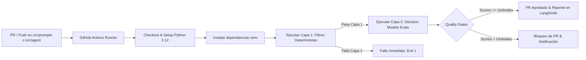

# Integración de Evaluaciones con Decision Models (Capa 2) en CI/CD

Este documento describe la arquitectura y el diseño propuesto para integrar las evaluaciones de **Modelos de Decisión (TypeSafe JEV / KEV)** como un *Quality Gate* automatizado dentro del pipeline de Integración Continua (CI/CD) en GitHub Actions.

---

## 1. Motivación y Objetivos

A diferencia de los enfoques tradicionales con *LLM-as-a-Judge* (que tardan de 3 a 10 minutos y conllevan altos costos por token de salida en cada ejecución de pipeline), los **Decision Models** permiten:
* **Ejecución ultrarrápida:** Latencia sub-segundo (~500 ms por caso de prueba), ejecutando un dataset completo de 10 a 20 casos en menos de 15 segundos.
* **Costo predecible y despreciable:** 0 tokens de salida autorregresiva. Con OpenRouter (~$0.0001 por inferencia) o con SLM local/contenedor (ej. `Kev-0.8B`), el costo marginal por commit es prácticamente nulo.
* **Métricas continuas calibradas:** Scores objetivos ($0.0 \dots 1.0$) y probabilidades de clase comparables entre diferentes versiones del agente y de los prompts.

---

## 2. Disparadores del Pipeline (Triggers)

El workflow se ejecutará automáticamente en GitHub Actions ante las siguientes condiciones:
* **Pull Requests** hacia las ramas `main` o `develop` que modifiquen archivos en:
  - `src/agent/**` (lógica del orquestador, nodos y schemas).
  - `src/prompts/**` (templates de prompts de clarificación, triaje o extracción).
  - `src/evaluation/**` (evaluadores y clasificadores).
  - `tests/agent_eval/**` (datasets y harness de evaluación).
* **Manual / Workflow Dispatch:** Posibilidad de disparar evaluaciones ad-hoc con parámetros personalizados (ej. cambiar modelo de decisión o dataset).

---

## 3. Arquitectura del Workflow en GitHub Actions



### Configuración del Job (`.github/workflows/decision_evals.yml`)

```yaml
name: "Decision Models Evals (CI Quality Gate)"

on:
  pull_request:
    paths:
      - "src/agent/**"
      - "src/prompts/**"
      - "src/evaluation/**"
      - "tests/agent_eval/**"
  workflow_dispatch:
    inputs:
      dataset:
        description: "Dataset a evaluar"
        required: true
        default: "dataset-ask-clarification"

jobs:
  evaluate-decision-models:
    runs-on: ubuntu-latest
    timeout-minutes: 5

    steps:
      - name: Checkout del repositorio
        uses: actions/checkout@v4

      - name: Configurar Python 3.12
        uses: actions/setup-python@v5
        with:
          python-version: "3.12"
          cache: "pip"

      - name: Instalar dependencias
        run: |
          python -m pip install --upgrade pip
          pip install -r requirements.txt
          pip install langchain-typesafe langsmith openrouter

      - name: Ejecutar Suite de Evaluación con Decision Models
        env:
          OPENROUTER_API_KEY: ${{ secrets.OPENROUTER_API_KEY }}
          LANGSMITH_API_KEY: ${{ secrets.LANGSMITH_API_KEY }}
          LANGSMITH_PROJECT: "redmine-rag-ci"
          DECISION_EVAL_MODEL: "typesafe/jev-1.13"
          AGENT_CLARIFICATION_MODEL: "deepseek/deepseek-v4-flash"
        run: |
          python -m tests.agent_eval.run_langsmith_evals --ci-mode --dataset dataset-ask-clarification

      - name: Publicar Resumen de Métricas en el PR
        if: always()
        uses: actions/github-script@v7
        with:
          script: |
            const fs = require('fs');
            if (fs.existsSync('eval_summary.md')) {
              const summary = fs.readFileSync('eval_summary.md', 'utf8');
              github.rest.issues.createComment({
                issue_number: context.issue.number,
                owner: context.repo.owner,
                repo: context.repo.repo,
                body: `### 🤖 Reporte de Evaluación de Modelos de Decisión\n\n${summary}`
              });
            }
```

---

## 4. Quality Gates y Umbrales de Aceptación (SLOs de Calidad)

Para evitar regresiones en los prompts y en las respuestas del agente, el script en `--ci-mode` retornará código de salida distinto de cero (`exit 1`) si no se cumplen los umbrales mínimos:

| Métrica / Evaluador | Umbral Mínimo de Aprobación | Acción ante Incumplimiento |
| :--- | :---: | :--- |
| **Tasa de Respuesta No Vacía (Capa 1)** | **100% (0 vacías)** | Bloqueo absoluto del PR. Indica fallo de inferencia o parsing. |
| **`clarification_technical_focus`** | **$\ge 0.75$** | Bloqueo del PR. Indica que se omitieron campos clave o se tocaron temas prohibidos. |
| **`clarification_tone_conciseness`** | **$\ge 0.70$** | Warning / Bloqueo si cae de $0.60$. |
| **`no_hallucination`** (en extracción) | **$\ge 0.90$** | Bloqueo del PR. Cero tolerancia a alucinaciones de endpoints o tablas. |
| **`extraction_completeness`** | **$\ge 0.75$** | Bloqueo del PR. |

---

## 5. Estrategia de Costo Cero: Alternativa con Contenedor SLM Local (KEV)

Si se desea prescindir de la API externa de OpenRouter en los runners de GitHub Actions:
1. Se puede inicializar un contenedor Docker ligero con el modelo de decisión local [`Kev-0.8B`](file:///home/santi/Documentos/LlamaIndex-RAG-Project/tests/benchmarks/config.py#L88) como un *Service Container* en el workflow:
   ```yaml
   services:
     kev-classifier:
       image: ghcr.io/santifie/kev-0.8b:latest
       ports:
         - 8009:8009
   ```
2. El evaluador apuntará a `http://127.0.0.1:8009/` con costo de API **$0.00**.
3. Permite que cualquier colaborador ejecute la suite de evaluación idéntica de forma local mediante un simple comando:
   ```bash
   make test-decision-evals
   ```
